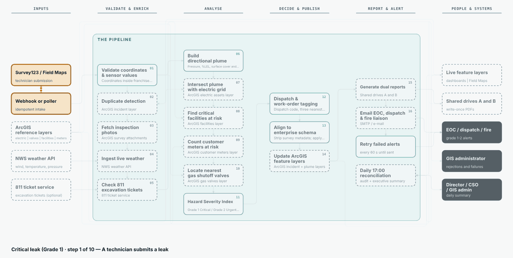

<div align="center">

# Esri Automation and Processing Scripts

**Ready-to-run GIS automation products** for ArcGIS Online / Enterprise, Survey123 and Field Maps -
object-oriented Python, `.env` placeholders, Jinja2 report templates and animated workflow diagrams generated from the code.


<p align="center"></p>

</div>

> [!IMPORTANT]
> **You need an Esri account for production use** - see [docs/esri-account-requirements.md](docs/esri-account-requirements.md).
> Products that can run offline say so and ship a no-Esri demo mode, so you can try them first.

## Products

| Product | Scenario | Status | Offline demo |
|---|---|---|:-:|
| ⛽⚡ [**gas-electric-leak-response**](products/gas-electric-leak-response) | Dual-service utility: underground gas leak near electric equipment - webhook intake, weather, plume, electric-asset intersect, hazard grade, live layer update, dual PDF reports, 17:00 reconciliation | Logic tested offline (104 tests); Esri calls **not yet verified on a live org** | ✅ |

More products will be added under `products/`. Conventions every product follows: [docs/adding-a-new-product.md](docs/adding-a-new-product.md).

## How a product is organized

```
products/<product-name>/
  README.md            what it does, quick start, generated animated diagram, verification status
  .env.example         every placeholder you fill in (never commit .env)
  config/              field mappings and tunables in YAML - no code changes for your data
  templates/           Jinja2 report + e-mail templates you can download and edit
  src/<package>/       object-oriented code: stages, clients, builders, commands
  examples/            sample outputs (synthetic data, neutral placeholders)
  tests/  docs/  scripts/
```

## Principles

* 🧱 **Object-oriented and replaceable** - every step is a class behind a small interface; swap a data source, a weather service or the PDF engine without touching the rest.
* 🔐 **Config over code** - secrets and URLs in `.env`; field names, thresholds and report layouts in YAML/HTML you can copy.
* 🗺 **Diagrams that cannot lie** - the animated pipeline diagram is generated from the real stage list; CI fails if it drifts.
* 🧪 **Honest verification** - each README says what was tested, what was not, and gives a checklist for your own org.
* 🛡 **Fail loud, never drop work** - validation lists everything missing; failed steps alert people and are retried.

## License
No license file has been chosen yet - add one before others reuse the code.
