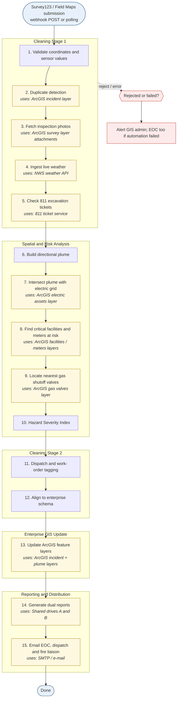
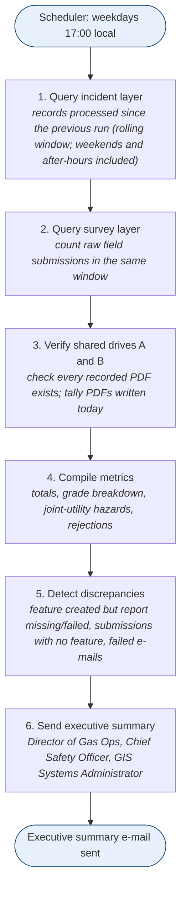

# Gas Leak / Electric Arcing Risk Response

Automation for **dual-service (electric + natural gas) utilities**: when a field technician submits a gas-leak
inspection, this service cross-references the electric grid, evaluates wind, builds a directional plume, grades the
hazard, updates your operational maps, writes two compliance PDFs to shared drives, e-mails the emergency coordinators,
and sends an executive reconciliation summary every business day at 17:00 (rolling window: nothing between runs is missed).

> **Safety notice.** The plume is a *screening-level heuristic*, not a validated dispersion model, and the valve list is
> *nearest valves*, not a traced upstream isolation plan. Outputs support - never replace - emergency procedures, field
> judgement and engineering review. Read [docs/limitations.md](docs/limitations.md) before operational use.

## What you need (and what you do not)

| Need | Required for | Notes |
|---|---|---|
| **An Esri account** - ArcGIS Online organization (or ArcGIS Enterprise) with a user able to create/edit hosted feature layers | Production mode | A free/personal ArcGIS account is **not** enough; Survey123 and hosted layer editing need an org subscription. |
| Survey123 (included with ArcGIS Online named users) or Field Maps | Field data capture | Form definition provided: `survey123/gas_leak_form.xlsx`. |
| Your enterprise reference layers: electric assets, gas valves, critical facilities (+ optional meters, franchise area) | Production mode | Map your field names in `config/layer_schema.yaml`. |
| Python 3.10+ | Everything | `pip install -r requirements.txt` |
| An SMTP server and shared-drive paths | Production mode | Or use `EMAIL_MODE=file` for testing. |
| A public HTTPS URL for the webhook **or** use the built-in polling mode | Webhook mode | Polling works behind a firewall. |
| **Nothing from Esri** | `python -m gas_electric_response demo` | Offline end-to-end demo on synthetic data. |

Full detail: [docs/esri-setup.md](docs/esri-setup.md) and the repo-level [Esri account requirements](../../docs/esri-account-requirements.md).

## Quick start

### 1. Try it without Esri (2 minutes)

```bash
cd products/gas-electric-leak-response
python -m venv .venv && source .venv/bin/activate        # Windows: .venv\Scripts\activate
pip install -r requirements.txt
PYTHONPATH=src python -m gas_electric_response demo       # Windows PowerShell: $env:PYTHONPATH="src"; python -m gas_electric_response demo
```

It runs four synthetic submissions (a Grade-1 leak beside a pad-mount transformer, a duplicate reading, a trace reading, and an
out-of-area submission) through the whole pipeline and writes PDFs, e-mails (`.eml`) and a daily summary into `./demo_output`.

### 2. Run it against your ArcGIS environment

1. `cp .env.example .env` and fill in the placeholders (every `REQUIRED` value). **Never commit `.env`.**
2. Edit `config/layer_schema.yaml` so field names / asset-type values match your layers.
3. Review `config/risk_parameters.yaml` with your gas engineering/safety group (the plume coefficients are placeholders).
4. Create the output service (dry run first): `PYTHONPATH=src python scripts/create_incident_service.py` then `--create`.
5. Publish the survey from `survey123/gas_leak_form.xlsx` using Survey123 Connect.
6. Verify everything read-only: `PYTHONPATH=src python -m gas_electric_response check`
7. Start receiving submissions - pick one:
   * Webhook: `python -m gas_electric_response serve` then add `https://<host>/webhooks/survey123?token=<WEBHOOK_TOKEN>` in Survey123 -> Settings -> Webhooks.
   * Polling (no inbound connection needed): `python -m gas_electric_response poll`
8. Schedule `python -m gas_electric_response reconcile` weekdays at 17:00 - see [docs/deployment.md](docs/deployment.md).

## How it works

Flow chart below is **generated from the code** (`python -m gas_electric_response flowchart --write`), and CI fails if it drifts.

<!-- FLOWCHART:PIPELINE:START -->

<!-- FLOWCHART:PIPELINE:END -->

<details><summary>Stage-by-stage table (also generated)</summary>

<!-- FLOWCHART:STAGES:START -->
| # | Stage | Group | What it does | Talks to |
|---|---|---|---|---|
| 1 | **Validate coordinates & sensor values** | Cleaning Stage 1 | Coordinates inside franchise area; reject impossible readings; flag suspicious ones | - |
| 2 | **Duplicate detection** | Cleaning Stage 1 | Another leak within 50 ft in the past 12 h => flag as duplicate reading | ArcGIS incident layer |
| 3 | **Fetch inspection photos** | Cleaning Stage 1 | Download photo attachments from the survey layer for the field ticket | ArcGIS survey layer attachments |
| 4 | **Ingest live weather** | Cleaning Stage 1 | Wind speed/direction, temperature and pressure for the leak location | NWS weather API |
| 5 | **Check 811 excavation tickets** | Cleaning Stage 1 | Active third-party dig tickets within 500 ft | 811 ticket service |
| 6 | **Build directional plume** | Spatial & Risk Analysis | Pressure, %LEL, surface cover and wind => dispersion envelope (not a circle) | - |
| 7 | **Intersect plume with electric grid** | Spatial & Risk Analysis | Pad-mount transformers / switchgear (spark) and underground conduit (migration) | ArcGIS electric assets layer |
| 8 | **Find critical facilities & meters at risk** | Spatial & Risk Analysis | Hospitals, schools, nursing homes inside the plume; customer meters counted | ArcGIS facilities / meters layers |
| 9 | **Locate nearest gas shutoff valves** | Spatial & Risk Analysis | Three closest valves (true upstream tracing needs a Utility Network trace) | ArcGIS gas valves layer |
| 10 | **Hazard Severity Index** | Spatial & Risk Analysis | Grade 1 Critical / Grade 2 Urgent / Grade 3 Monitored | - |
| 11 | **Dispatch & work-order tagging** | Cleaning Stage 2 | Dispatch code, three nearest shutoff valves, status Active_Triage | - |
| 12 | **Align to enterprise schema** | Cleaning Stage 2 | Strip survey metadata; apply field names, types and integer status codes | - |
| 13 | **Update ArcGIS feature layers** | Enterprise GIS Update | Incident point, plume polygon, grade and valve references (dashboards/Field Maps update live) | ArcGIS incident + plume layers |
| 14 | **Generate dual reports** | Reporting & Distribution | Report 1 Field Ticket -> Shared Drive A; Report 2 Hazard Assessment -> Shared Drive B | Shared drives A and B |
| 15 | **Email EOC, dispatch & fire liaison** | Reporting & Distribution | Grades 1-2 only: Report 2 attached, sent immediately | SMTP / e-mail |
<!-- FLOWCHART:STAGES:END -->

</details>

### Daily 17:00 reconciliation

<!-- FLOWCHART:RECONCILE:START -->

<!-- FLOWCHART:RECONCILE:END -->

### Hazard Severity Index (summary)

| Grade | Rule (defaults; configurable) |
|---|---|
| **1 Critical** | > 20 % LEL and the plume overlaps an electric ignition source / underground conduit, or a critical facility |
| **2 Urgent** | >= 10 % LEL, **or** measurable gas (>= 1 % LEL) with an electric asset, critical facility or customer meter inside the plume |
| **3 Monitored** | Everything else (low reading and nothing at risk in the plume) |

Details, edge cases and the interpretation choices to confirm: [docs/hazard-grading.md](docs/hazard-grading.md).

## What gets produced

* **ArcGIS layers** (`Active_Gas_Electric_Incidents`): incident points (grade, dispatch code, valve IDs, counts, status `Active_Triage`) and plume polygons - dashboards, Field Maps and control-room screens update live.
* **Report 1 - Field Ticket (PDF)** -> `REPORT_PATH_A/YYYY-MM/`: technician inputs, readings, photos, badge, timestamps. Write-once, SHA-256 sidecar, read-back verified.
* **Report 2 - Ignition & Hazard Assessment (PDF)** -> `REPORT_PATH_B/YYYY-MM/`: plume map, electric assets at risk, facilities, meters, valves, grade. E-mailed immediately for Grade 1-2.
* **Daily summary e-mail** with totals, grade breakdown, joint-utility hazards (e.g. "gas within 20 ft of an energized pad-mount") and discrepancy checks.

## Project layout

```
src/gas_electric_response/
  config.py  models.py  geo.py  plume.py  pipeline.py  bootstrap.py
  clients/    store.py (FeatureStore interface + in-memory) arcgis_store.py weather.py excavation.py
  stages/     ingest.py analysis.py transform.py publish.py reporting.py notify.py   <- the pipeline steps
  reports/    pdf.py maps.py storage.py
  receiver/   app.py (FastAPI webhook) worker.py payload.py          poller.py  reconcile.py  cli.py
config/       layer_schema.yaml  risk_parameters.yaml
scripts/      create_incident_service.py  build_xlsform.py  make_sample_data.py
survey123/    gas_leak_form.xlsx
tests/        68 tests (run: PYTHONPATH=src pytest)
docs/         esri-setup  hazard-grading  deployment  security  limitations  excavation-811
```

## Extending

Everything is an object behind an interface: add a `Stage` subclass and list it in `bootstrap.build_stages()`; swap a data source by
implementing `FeatureStore`, `WeatherClient` or `ExcavationTicketClient`. The flow chart regenerates itself.

## Verification status (be honest about what was and was not tested)

| Area | Status |
|---|---|
| Business logic: validation, dedupe/escalation, plume orientation, grading, schema mapping, reports, storage, e-mail, reconcile, webhook auth | **Unit/integration tested** (68 tests, offline, synthetic data; includes regression tests from an independent code review) |
| `ArcGISFeatureStore`, `create_incident_service.py`, GIS login | Written against the ArcGIS API for Python (signatures checked by introspection); **NOT run against a live Esri org** |
| NWS weather client | Unit-tested on parsing/units only; **never called the live API from the development environment** |
| Survey123 webhook payload & field behaviour | Receiver only extracts an ID and re-reads the record (robust to shape differences) but **not tested with real Survey123 traffic** |
| SMTP, UNC shares, Windows scheduling | **Untested**; file-mode e-mail and local paths are tested |

Run `check`, then submit test surveys and compare against [docs/limitations.md](docs/limitations.md). Please report what breaks.
