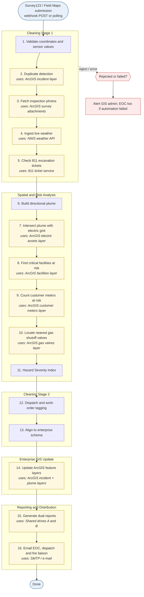
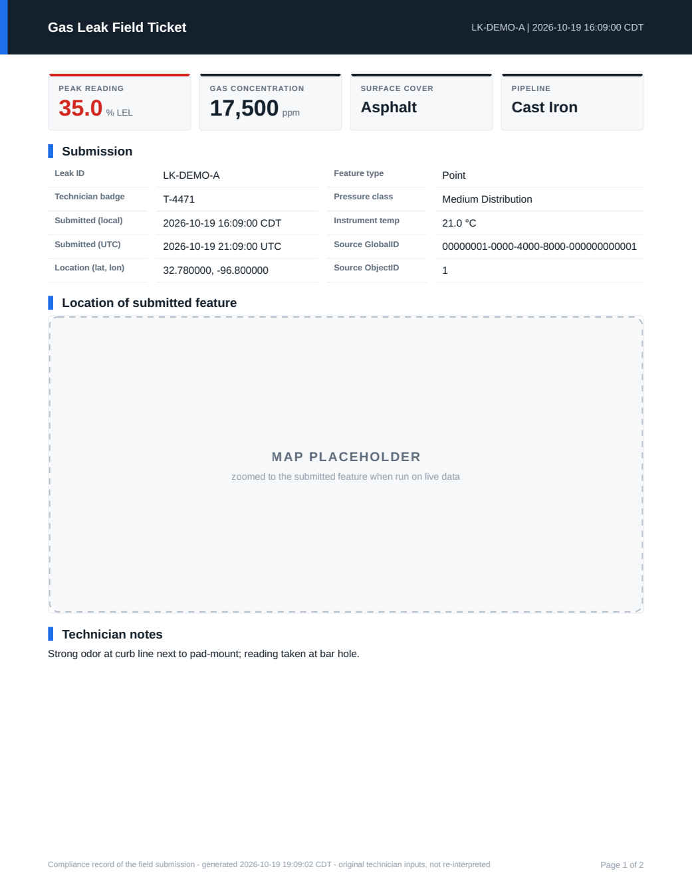
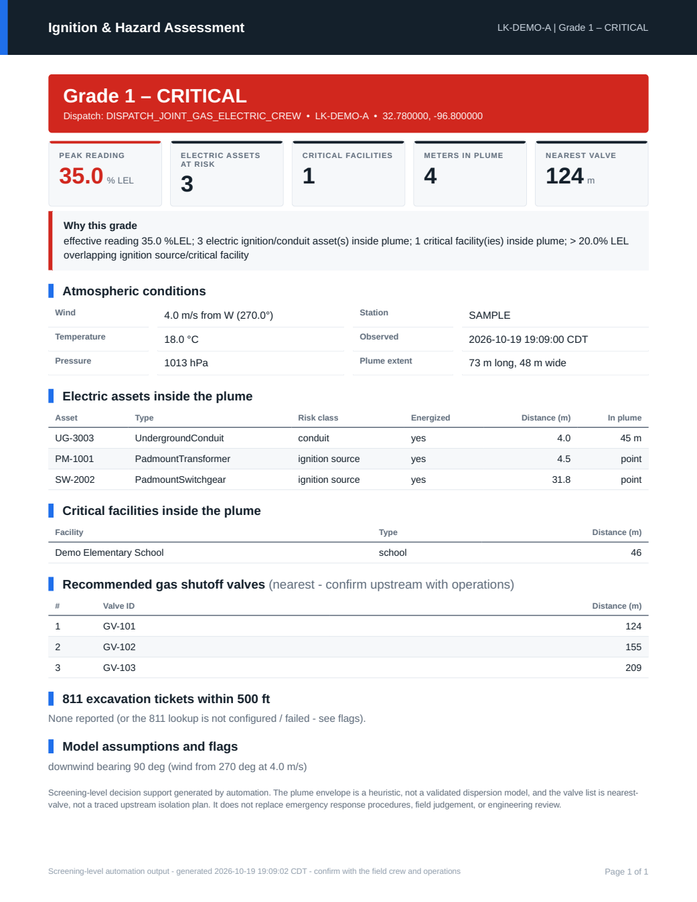

<div align="center">

# Gas Leak / Electric Arcing Risk Response

**Field submission &rarr; weather &rarr; plume &rarr; electric-grid analysis &rarr; hazard grade &rarr; live map &rarr; PDF reports &rarr; alerts &rarr; daily audit**
for dual-service (electric + natural gas) utilities, built on ArcGIS Survey123 and feature services.


<p align="center"></p>

</div>

> [!WARNING]
> **Safety notice.** The plume is a *screening-level heuristic*, not a validated dispersion model, and the valve list is *nearest valves*, not a traced upstream isolation plan.
> Outputs support - never replace - emergency procedures, field judgement and engineering review. Read [docs/limitations.md](docs/limitations.md) before operational use.

**Jump to:** [Quick start](#quick-start) &bull; [How it works](#how-it-works) &bull; [Reports](#reports-and-templates) &bull; [Adapt it](#adapt-it-to-your-data) &bull; [Layout](#project-layout) &bull; [Verification status](#verification-status)

---

## What you need

| Need | For | Notes |
|---|---|---|
| **An Esri account** - ArcGIS Online organization (or ArcGIS Enterprise) with a user who can create/edit hosted feature layers | Production mode | A free/personal account is **not** enough. Survey123 + hosted layer editing need an org subscription |
| Survey123 (included with ArcGIS Online named users) or Field Maps | Field capture | Form provided: [`survey123/gas_leak_form.xlsx`](survey123/gas_leak_form.xlsx) |
| Your enterprise layers: electric assets, gas valves, critical facilities (+ optional meters, franchise area) | Production mode | Map your field names in `config/layer_schema.yaml` |
| Python 3.10+ and `pip install -r requirements.txt` | Everything | PDF engine [WeasyPrint](https://weasyprint.org) needs Pango (Windows: GTK runtime) - see [docs/report-templates.md](docs/report-templates.md#7-pdf-engine-requirements) |
| SMTP server + shared-drive paths | Production mode | or `EMAIL_MODE=file` for testing |
| A public HTTPS URL for the webhook **or** the built-in polling mode | Intake | polling works behind a firewall |
| **Nothing from Esri** | `python -m gas_electric_response demo` | offline end-to-end demo on synthetic data |

Details: [docs/esri-setup.md](docs/esri-setup.md) and the repo-level [Esri account requirements](../../docs/esri-account-requirements.md).

## Quick start

### 1 &middot; Try it without Esri (2 minutes)

```bash
cd products/gas-electric-leak-response
python -m venv .venv && source .venv/bin/activate         # Windows: .venv\Scripts\activate
pip install -r requirements.txt
PYTHONPATH=src python -m gas_electric_response demo       # PowerShell: $env:PYTHONPATH="src"; python -m gas_electric_response demo
```

Four synthetic submissions (a Grade-1 leak beside a pad-mount transformer, a duplicate reading, a trace reading, and an out-of-area submission) run through the whole pipeline.
You get PDFs, `.eml` e-mails and a daily summary in `./demo_output`. Pre-built samples are in [`examples/`](examples).

### 2 &middot; Run it against your ArcGIS environment

1. `cp .env.example .env` and fill the placeholders (every `REQUIRED` value). **Never commit `.env`.**
2. Edit `config/layer_schema.yaml` so field names / asset-type values match your layers.
3. Review `config/risk_parameters.yaml` with your gas engineering/safety group (the plume coefficients are placeholders).
4. Create the output service - dry run first: `python scripts/create_incident_service.py`, then `--create`.
5. Publish the survey from `survey123/gas_leak_form.xlsx` with Survey123 Connect.
6. Verify, read-only: `PYTHONPATH=src python -m gas_electric_response check`
7. Receive submissions - webhook: `python -m gas_electric_response serve` and add `https://<host>/webhooks/survey123?token=<WEBHOOK_TOKEN>` in Survey123 &rarr; Settings &rarr; Webhooks; or polling: `python -m gas_electric_response poll`.
8. Schedule `python -m gas_electric_response reconcile` weekdays at 17:00 - see [docs/deployment.md](docs/deployment.md).

## How it works

The diagram above and the table below are **generated from the code** (`python -m gas_electric_response flowchart --write`); CI fails if they drift.

<!-- FLOWCHART:PIPELINE:START -->
<p align="center"></p>

<details><summary>Static fallback (Mermaid)</summary>



</details>
<!-- FLOWCHART:PIPELINE:END -->

<details><summary><b>Stage-by-stage table</b> (also generated)</summary>

<!-- FLOWCHART:STAGES:START -->
| # | Stage | Group | What it does | Talks to |
|:-:|---|---|---|---|
| 1 | **Validate coordinates & sensor values** | Cleaning Stage 1 | Coordinates inside franchise area; reject impossible readings; flag suspicious ones | – |
| 2 | **Duplicate detection** | Cleaning Stage 1 | Another leak within 50 ft in the past 12 h => flag as duplicate reading | ArcGIS incident layer |
| 3 | **Fetch inspection photos** | Cleaning Stage 1 | Download photo attachments from the survey layer for the field ticket | ArcGIS survey attachments |
| 4 | **Ingest live weather** | Cleaning Stage 1 | Wind speed/direction, temperature and pressure for the leak location | NWS weather API |
| 5 | **Check 811 excavation tickets** | Cleaning Stage 1 | Active third-party dig tickets within 500 ft | 811 ticket service |
| 6 | **Build directional plume** | Spatial & Risk Analysis | Pressure, %LEL, surface cover and wind => dispersion envelope (not a circle) | – |
| 7 | **Intersect plume with electric grid** | Spatial & Risk Analysis | Pad-mount transformers / switchgear (spark) and underground conduit (migration) | ArcGIS electric assets layer |
| 8 | **Find critical facilities at risk** | Spatial & Risk Analysis | Hospitals, schools, nursing homes inside the plume | ArcGIS facilities layer |
| 9 | **Count customer meters at risk** | Spatial & Risk Analysis | Customer meters inside the plume (proxy for occupied structures) | ArcGIS customer meters layer |
| 10 | **Locate nearest gas shutoff valves** | Spatial & Risk Analysis | Three closest valves (true upstream tracing needs a Utility Network trace) | ArcGIS gas valves layer |
| 11 | **Hazard Severity Index** | Spatial & Risk Analysis | Grade 1 Critical / Grade 2 Urgent / Grade 3 Monitored | – |
| 12 | **Dispatch & work-order tagging** | Cleaning Stage 2 | Dispatch code, three nearest shutoff valves, status Active_Triage | – |
| 13 | **Align to enterprise schema** | Cleaning Stage 2 | Strip survey metadata; apply field names, types and integer status codes | – |
| 14 | **Update ArcGIS feature layers** | Enterprise GIS Update | Incident point, plume polygon, grade and valve references (dashboards/Field Maps update live) | ArcGIS incident + plume layers |
| 15 | **Generate dual reports** | Reporting & Distribution | Report 1 Field Ticket (with zoomed map) -> Shared Drive A; Report 2 Hazard Assessment -> Shared Drive B | Shared drives A and B |
| 16 | **Email EOC, dispatch & fire liaison** | Reporting & Distribution | Grades 1-2 only: Report 2 attached, sent immediately | SMTP / e-mail |
<!-- FLOWCHART:STAGES:END -->

</details>

### Daily reconciliation

<!-- FLOWCHART:RECONCILE:START -->
<p align="center"></p>
<!-- FLOWCHART:RECONCILE:END -->

### Hazard Severity Index

| Grade | Rule (defaults; configurable) |
|:-:|---|
| 🔴 **1 Critical** | > 20 % LEL **and** the plume overlaps an electric ignition source / underground conduit, or a critical facility |
| 🟠 **2 Urgent** | >= 10 % LEL, **or** measurable gas (>= 1 % LEL) with an electric asset, critical facility or customer meter inside the plume |
| 🟢 **3 Monitored** | everything else |

Edge cases and the interpretation choices to confirm: [docs/hazard-grading.md](docs/hazard-grading.md).

## Reports and templates

Reports and e-mails are **Jinja2 templates** in the downloadable [`templates/`](templates) folder: HTML with `{{ placeholders }}`, `` loops and `` conditions, a
`{{ map(...) }}` call that draws a **map zoomed to the submitted feature**, and a shared stylesheet/palette. Copy the folder, edit, point `.env` at it - no Python required.

<table>
<tr>
<td width="50%" align="center"><b>Report 1 &middot; Field Ticket</b><br/><sub>submission record · zoomed map · photos</sub><br/></td>
<td width="50%" align="center"><b>Report 2 &middot; Hazard Assessment</b><br/><sub>grade · electric assets · facilities · valves</sub><br/></td>
</tr>
</table>

<sub>Examples use synthetic data. Maps and photos appear as neutral **placeholders** in the demo and are filled with the real map and survey photos on live data. PDFs: [`examples/`](examples).</sub>

```jinja
{{ kpi("Peak reading", report.effective_lel_pct | fmt('.1f'), "% LEL", grade.color) }}
{{ map(zoom_m=140, layers=['electric', 'valves']) }}              {# zoomed to the point / line / polygon the technician submitted #}
{{ row.asset_id }} - {{ row.in_plume }}
```

* 📘 **[Report template guide](docs/report-templates.md)** - variables, tables, filters, map options, styling, examples
* 🛠 `python -m gas_electric_response preview templates/field_ticket.html` - re-render a template in seconds (PDF + HTML)
* 🔎 `python -m gas_electric_response template-help` - list every variable, table, helper and filter

### What gets produced

| Output | Where | Notes |
|---|---|---|
| **ArcGIS layers** `Active_Gas_Electric_Incidents` | your org | incident points (grade, dispatch code, valves, counts, `Active_Triage`) + plume polygons; dashboards/Field Maps update live |
| **Report 1 - Field Ticket (PDF)** | `REPORT_PATH_A/YYYY-MM/` | write-once, SHA-256 sidecar, read-back verified |
| **Report 2 - Hazard Assessment (PDF)** | `REPORT_PATH_B/YYYY-MM/` | e-mailed immediately for Grade 1-2 |
| **Alert e-mail** | EOC · electric dispatch · fire liaison | HTML + plain text, PDF attached, retried until delivered |
| **Daily executive summary** | director · CSO · GIS admin | totals, grades, joint hazards (e.g. gas within 20 ft of an energized pad-mount), discrepancies |

## Adapt it to your data

The gas/electric scenario is one configuration of a general **intake → clean → analyse → grade → publish → report → notify** pipeline.
[**docs/adapting-the-pipeline.md**](docs/adapting-the-pipeline.md) shows how to change it for other analyses and for **point, line and polygon** datasets:

| I want to... | Do this |
|---|---|
| use different field names / codes | edit `config/layer_schema.yaml` (no code) |
| submit **lines or polygons** instead of points | nothing - geometry is handled generically (plume wraps the whole feature) |
| analyse a new point / line / polygon layer | subclass `OverlayStage` (≈20 lines); lines report length-in-plume, polygons area-in-plume |
| change the grading rule or the footprint model | subclass `GradingPolicy` / `PlumeModel` |
| use a non-ArcGIS data source | implement `FeatureStore` |
| change what reports say or look like | edit the Jinja2 templates |

Everything is an object behind a small interface (`Stage`, `OverlayStage`, `FeatureStore`, `WeatherClient`, `PdfEngine`, ...); add a `Stage` to `PipelineBuilder.stages()` and the diagrams regenerate.

## Project layout

```
src/gas_electric_response/
  bootstrap.py        PipelineBuilder · ProductionRuntimeFactory · DemoRuntimeFactory       <- the pipeline is defined here
  stages/             ingest · analysis (OverlayStage family, GradingPolicy) · transform · publish · reporting · notify
  clients/            FeatureStore (ArcGIS + in-memory) · NWS weather · 811 tickets
  reports/            engine (Jinja2 + PdfEngine) · data (template variables) · mapping (zoomed maps, tile basemap) · emails · storage
  receiver/           FastAPI webhook app · worker · payload parser          poller.py · retry.py · reconcile.py
  plume.py  geo.py  models.py  config.py  svgflow.py + flowchart.py (animated README diagrams)  cli.py (command classes)
config/      layer_schema.yaml · risk_parameters.yaml          survey123/   gas_leak_form.xlsx
templates/   field_ticket.html · risk_assessment.html · email_*.html · report.css · theme.yaml · partials/      <- download / copy these
examples/    sample PDFs and e-mails (synthetic data)          sample_data/ synthetic GeoJSON layers (no images)
scripts/     create_incident_service · build_xlsform · make_sample_data · build_examples
tests/       96 offline tests (PYTHONPATH=src pytest)           docs/        guides
```

## Documentation

[Report templates](docs/report-templates.md) · [Adapting the pipeline](docs/adapting-the-pipeline.md) · [Esri setup](docs/esri-setup.md) · [Hazard grading](docs/hazard-grading.md) ·
[Deployment](docs/deployment.md) · [Security](docs/security.md) · [811 tickets](docs/excavation-811.md) · [Limitations & checklist](docs/limitations.md)

## Verification status

Be honest about what was and was not tested.

| Area | Status |
|---|---|
| Business logic - validation, dedupe/escalation, plume orientation (point/line/polygon), grading, schema mapping, report engine, storage, e-mail, reconcile, webhook auth | ✅ **96 offline tests** on synthetic data (incl. regression tests from an independent code review) |
| Report PDFs and animated diagrams | ✅ rendered and inspected visually in the development environment |
| `ArcGISFeatureStore`, `create_incident_service.py`, GIS sign-in | ⚠️ written against the ArcGIS API for Python (signatures checked by introspection) but **not run against a live Esri org** |
| NWS weather client | ⚠️ parsing/units unit-tested; **never called the live API** from the dev environment |
| Online basemap tiles for report maps | ⚠️ tile math unit-tested logic only; **not fetched live** here (default `basemap: none` is fully offline) |
| Survey123 webhook payload & real traffic | ⚠️ receiver only extracts an ID and re-reads the record (robust to shape differences); **not tested with real Survey123 traffic** |
| SMTP, UNC shares, Windows scheduling/WeasyPrint on Windows | ⚠️ **untested**; file-mode e-mail and local paths are tested |

Run `check`, submit test surveys, and walk the checklist in [docs/limitations.md](docs/limitations.md). Please report what breaks.
